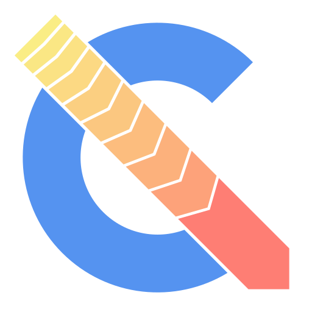

> **This is a fork of [RealNeGate/Cuik](https://github.com/RealNeGate/Cuik)** (MIT
> license, © Yasser Arguelles Snape) — the TB-library companion of
> [odin-tilde](https://github.com/vajraimb/odin-tilde), containing the fixes the
> Odin tilde backend depends on. Check out tag `v0.1.0-beta` for the matched pair.

**warning: unfinished and buggy...**

## Resources

* [discord](https://discord.gg/UFuHChZswc)
* [build from source](https://github.com/RealNeGate/Cuik/blob/master/docs/BUILDING.txt)
* [code structure](https://github.com/RealNeGate/Cuik/blob/master/docs/STRUCTURE.txt)

## Summary

Cuik (pronounced 'Quick') is a new fast compiler toolchain built to replace GCC, MSVC, and LLVM. It's built in a modular design, the C11 frontend is one library (`libCuik`) along with the backend (`tb`) which can both be compiled separately.
